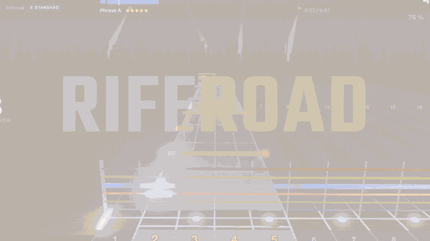

# Riffroad

*Français : [README.fr.md](README.fr.md)*



A guitar game for macOS. Plug in a real electric guitar, drop in any MP3, and play it on a 3D
note highway, with real-time note detection, an amp simulator and a career from the garage to
the stadium.

- **Any song you have**: an MP3 (or WAV, FLAC, M4A…) is split into stems (Demucs), the guitar
  transcribed (Basic Pitch) and fingered on the neck (a Viterbi solver), with five difficulty
  levels. Put a Guitar Pro tab next to the MP3 and Riffroad uses its notes instead, synced to
  the recording. Songs charted by hand in feedBack's open
  [feedpak](https://github.com/got-feedBack/feedpak-spec) format play as written, with their
  audio.
- **Your real guitar**: pitch and chord detection in Rust at 48 kHz with 64-sample buffers,
  latency calibration, a tuner, and an amp with clean, crunch, lead and metal channels.
- **Practice**: Loop Trainer (loop a passage, slow it down without changing the pitch, speed
  it up as you nail it), dynamic difficulty, mastery per phrase, Master mode, Score Attack.
- **Career**: weekly gigs, a setlist, a crowd that reacts to every note, a band, gear, a label,
  festivals and a rival band.
- **Online, if you want** (desktop app, free account): your career and progress on all your
  Macs, the five saves before each kept; the **World challenge**, one of the game's songs each
  week with one board for everyone; a **ghost** to race in Score Attack; a **streak** of days
  played; the **battle of the bands** with your friends' bands; and events such as weekend
  festivals. The server is open source too ([cloud/](cloud/README.md)).
- **Five songs** are in the library from the first launch, to play right away.

## Requirements

- A Mac with Apple Silicon (M1 or later), macOS 13 Ventura or later.
- An electric guitar and a way into the Mac: the USB **Real Tone Cable** (detected
  automatically) or any audio interface. Headphones recommended.
- To import songs: [uv](https://docs.astral.sh/uv/) and ffmpeg (`brew install uv ffmpeg`),
  about 2 GB of disk for the song converter, which installs itself on the first import.

## Install

**Download**: get the `.dmg` from the [Releases](../../releases) page and drag Riffroad to
Applications. Builds are not signed by Apple yet: the first time, macOS refuses to open the
app. Open **System Settings → Privacy & Security** and click **Open Anyway** (on macOS 13–14:
right-click the app → Open), or run:

```bash
xattr -dr com.apple.quarantine /Applications/Riffroad.app
```

**Build from source** (Rust, Node 20+, uv):

```bash
cd app && npm install && npm run tauri build
```

The app lands in `app/src-tauri/target/release/bundle/`. See
[docs/macos-release.md](docs/macos-release.md) for signing and notarisation.

## First steps

1. Open Riffroad. A short guide has you plug in the guitar, set the input level, calibrate the
   latency (strum on 12 clicks) and tune.
2. **Songs**: five songs to start with: First Riff, made for a first try, and four rock songs
   by Shane Ivers (CC BY 4.0), the band playing around your guitar. Space pauses, `?` lists
   every shortcut.
3. Import your own music: drop MP3s, a Guitar Pro tab, a feedpak or a whole folder on the
   window. Each song takes about half a minute on an M-series Mac (the first import also
   installs the converter, a few minutes).
4. Try **Career**, **Loop Trainer** on a hard passage, and **Settings → Game → Language**
   (English or French).
5. **Settings → Account**: an account keeps your saves on all your Macs and puts you on the
   **World challenge** board (menu). Confirm your e-mail with the link you receive.

No guitar at hand? The **Auto demo** switch (top right) lets the game play by itself.

## FAQ

**Does it come with songs?** Five: First Riff, generated by code, and four rock songs by Shane
Ivers under CC BY 4.0. Beyond those you bring your own music: Riffroad converts the files you
have, on your Mac, and your songs never leave it.

**What goes online?** Nothing without an account. With one: your career and progress saves (and
the five before each), the name you choose for the boards, your World challenge runs, and your
band's card for your friends (its name, act and fans). Never your songs, your e-mail is never
shown, and **Settings → Account → Delete my account** erases all of it.

**How good are the charts made from an MP3?** Fine for riffs and clear parts; rough on dense,
distorted or layered guitars, where the AI misses many notes. For an exact chart, put the song's
Guitar Pro tab (`.gp3`/`.gp4`/`.gp5`) next to the MP3 with a similar name: Riffroad takes its
notes and syncs them to the recording.

**Do I need the Real Tone Cable?** No. Any audio interface works; pick its input in
**Settings → Audio & guitar**. The cable is simply found on its own.

**Other file formats?** feedpak songs (`.feedpak` archives or folders) import as they are: the
chart as its author wrote it (with its difficulty levels when it has some) and the pack's audio.
Beyond that, the song converter takes plugins: a Python package that adds an import
command (see [CONTRIBUTING.md](CONTRIBUTING.md)). Once installed, the app accepts its files like
MP3s.

**Windows, Linux, Intel Macs?** Not yet. Windows and Linux ports are under way; the hard part is
a latency fit for guitar. Windows' shared audio mode adds 25–40 ms, so the engine needs WASAPI
exclusive mode or ASIO; Linux needs PipeWire (or JACK) and a check that the 3D highway holds
60 fps in its web view. If you know these audio APIs, help is welcome: see
[CONTRIBUTING.md](CONTRIBUTING.md). There is no Intel Mac build today.

**Where are my songs?** In `~/Music/OpenSmith` (the game's former name), one folder per song (chart, backing track,
cover).

## For developers

[CONTRIBUTING.md](CONTRIBUTING.md) explains the layout, setup and tests; [cloud/README.md](cloud/README.md)
the online server (tests against the Firebase emulators, deployment, events). The command-line
tools (`opensmith-ingest` to convert songs, `opensmith-diag` to test the audio engine) and every
feature of the app are described in [docs/guide.fr.md](docs/guide.fr.md) (French);
[PROGRESS.md](PROGRESS.md) is the (French) log of what was built and measured.

## License

Riffroad is free software under the [GNU General Public License v3.0 or later](LICENSE):
you may use, study, share and modify it; versions you distribute must stay under the same
licence, with their source. Third-party components keep their own licences
([THIRD_PARTY_NOTICES.md](THIRD_PARTY_NOTICES.md)).

## Trademarks

Rocksmith® is a trademark of Ubisoft Entertainment. Riffroad is an independent project, not
affiliated with, endorsed or sponsored by Ubisoft. It contains no content, code or encryption
keys from the game; Rocksmith is named only to identify compatible hardware (the Real Tone
Cable).
